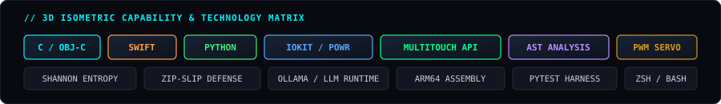

  <!-- 3D Isometric Cyberpunk Animated Banner -->
  

   

  <!-- Quick Command HUD & Direct Links -->
  

    
    
    
    
  

  

### 📡 Real-Time Telemetry & Workspace Vitals

  

 

<!-- Streak Counter Section -->

  

  

### 🛸 Featured Systems & Pinned Showcases

  <table border="0" style="border: none; background: transparent;">
    <tr style="border: none; background: transparent;">
      <td width="50%" style="border: none; background: transparent;">
        
      </td>
      <td width="50%" style="border: none; background: transparent;">
        
      </td>
    </tr>
  </table>

  

  

### ⚡ 3D Technology Matrix

  

---

### 🔬 Core Engineering Projects

| System | Technology & Architecture | Verified Characteristics | Status |
| :--- | :--- | :--- | :--- |
| **[VeriPack](https://github.com/anant-rajj/pratyancha-hacktoberfest)** | Python &bull; AST Traversal &bull; Shannon Entropy &bull; Safe Tarball Ingestion | Team Lead (`Team pratyancha`) &bull; Hack Day Sonipat Problem 04 &bull; Zip-Slip defense (`Path.relative_to`) &bull; 42/42 Tests Green | `VERIFIED PRODUCTION` |
| **[mac-insomnia](https://github.com/anant-rajj/mac-insomnia)** | macOS CLI &bull; Apple IOKit `IOPMAssertion` &bull; Signal Traps | **~24 KB disk usage** &bull; **&lt; 8 MB RAM** &bull; 0 MB idle GUI overhead &bull; Lid-closed stay-awake daemon | `PROTOTYPE / OPEN SOURCE` |
| **[mac-lumitrack](https://github.com/anant-rajj/mac-lumitrack)** | Pure C / Objective-C &bull; `CoreBrightness` &bull; `MultitouchSupport` | **~50 KB binary** &bull; **~3.5 MB RSS** &bull; Trackpad slide backlight control with `Command (⌘)` / `Fn` | `ACTIVE UTILITY` |
| **[mac-keyglow](https://github.com/anant-rajj/mac-keyglow)** | Native Swift &bull; Mathematical Animation Engine &bull; Bezel HUD | **45–60 FPS hardware loop** &bull; **&lt; 0.2% CPU** &bull; Instant Strike &bull; Menu Bar + CLI controls | `ACTIVE STUDIO` |
| **[mac-haptics](https://github.com/anant-rajj/mac-haptics)** | Private Multitouch Actuator &bull; Low-Level Event Taps | Force Touch Taptic Engine feedback suite for Apple Silicon MacBooks (typing &amp; notifications) | `R&D LAB` |
| **[ThermoX](https://thermox.ai.studio/)** | Industrial Concept &bull; Modular Cartridge Thermal Engineering | Modular cooling cartridge bottle separating fluid reservoir from thermal core | `CONCEPT PORTAL` |

---

### 🏛️ Initiatives & Track Record

* **E-Cell IIT Bombay — National Entrepreneurship Challenge (NEC)**: Advanced Track (Team Ignitrones) &bull; Ecosystem building, on-campus execution models, technical documentation, and offline crisis simulations at IIT Bombay E-Summit.
* **Eureka! Competition**: E-Cell IIT Bombay flagship product initiative &bull; Feedback-driven architectural redesign and rapid prototyping.
* **Student Athletics**: Competitive 100m / 200m sprinting and long-distance marathons &bull; Discipline, stamina, and continuous improvement.

---

  

    <strong>RESEARCH &bull; UNDERSTAND &bull; DESIGN &bull; IMPLEMENT &bull; TEST &bull; IMPROVE</strong>
  

  

    <a href="https://anant-rajj.github.io/portfolio/">🌐 anant-rajj.github.io/portfolio</a> &bull; 
    <a href="mailto:anantraj.clcs@gmail.com">✉ anantraj.clcs@gmail.com</a>
  

  &copy; 2026 Anant Raj &bull; Systems Engineering &amp; Robotics

