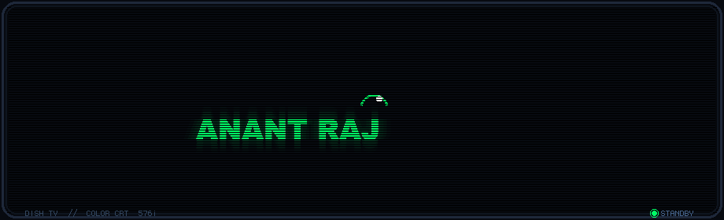
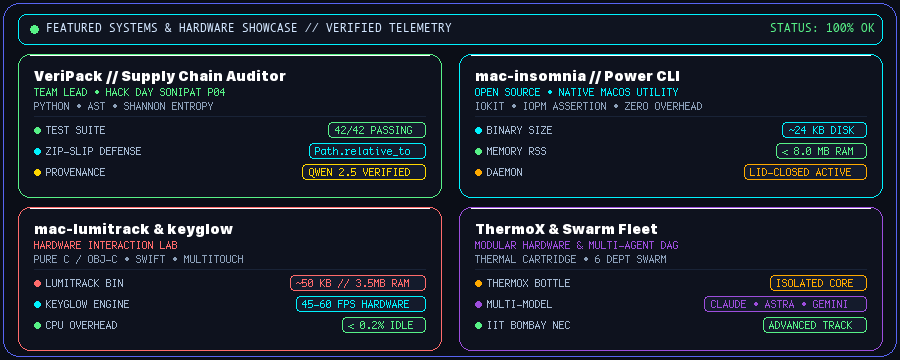
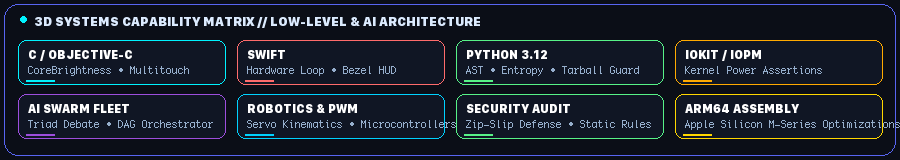

  <!-- Classic Retro CRT Television — Dish TV Bouncing Screensaver -->
  

   

  <!-- Discord Nitro Profile HUD Navigation Buttons -->
  

    
    
    
    
    
  

  <!-- Fluid Wave Divider (SMIL Dynamic SVG Animation) -->
  

### 📡 Real-Time Telemetry & Workspace Vitals

  <!-- Discord Status Card Callout -->
  

    <code>🟢 DISCORD STATUS</code> &bull; <strong>ACTIVE // BUILDING NATIVE MACOS HARDWARE CONTROLS & AI SWARMS</strong>
  

  <!-- GitHub Streak Counter (Discord Cyberpunk Tokyonight Theme) -->
  

 

  

### 🛸 Featured Systems & Pinned Showcases

  <!-- Animated Telemetry & Pinned Showcases HUD -->
  

 

#### 🔬 Deep-Dive Project Cards

<table>
  <tr>
    <td width="50%" valign="top" style="background-color: #0d1117; border: 1px solid #57f287; border-radius: 8px;">
      <h3 align="center">🛡️ VeriPack (pratyancha)</h3>
      

        
        
      

      
<strong>Package Supply-Chain Security &amp; AST Analysis</strong>

      <ul>
        <li><strong>Role:</strong> Team Lead (<code>Team pratyancha</code>) &bull; Hack Day Sonipat Problem 04</li>
        <li><strong>Deterministic Security:</strong> <code>Path.relative_to</code> Zip-Slip path traversal defense</li>
        <li><strong>Analysis:</strong> AST token visitor &bull; Shannon entropy anomaly detection</li>
        <li><strong>Status:</strong> <code>42/42 TESTS GREEN</code> &bull; PEP 621 Standard Manifest</li>
      </ul>
    </td>
    <td width="50%" valign="top" style="background-color: #0d1117; border: 1px solid #00f2fe; border-radius: 8px;">
      <h3 align="center">⚡ mac-insomnia</h3>
      

        
        
      

      
<strong>Native macOS Lid-Closed Stay-Awake Daemon</strong>

      <ul>
        <li><strong>Architecture:</strong> macOS CLI utility leveraging Apple IOKit <code>IOPMAssertionCreateWithName</code></li>
        <li><strong>Resource Overhead:</strong> <strong>~24 KB disk usage</strong> &bull; <strong>&lt; 8 MB RAM</strong></li>
        <li><strong>Zero GUI:</strong> Built for autonomous AI agents, local LLM serving &amp; long compiles</li>
        <li><strong>Safety:</strong> Robust signal trapping (SIGINT/SIGTERM) ensuring zero sleep-leak</li>
      </ul>
    </td>
  </tr>
  <tr>
    <td width="50%" valign="top" style="background-color: #0d1117; border: 1px solid #ff6b6b; border-radius: 8px;">
      <h3 align="center">🎛️ mac-lumitrack &amp; mac-keyglow</h3>
      

        
        
      

      
<strong>Native C / Objective-C &amp; Swift Hardware Controls</strong>

      <ul>
        <li><strong>LumiTrack:</strong> <strong>~50 KB binary</strong> &bull; <strong>~3.5 MB RSS</strong> &bull; Trackpad slide backlight control via private <code>CoreBrightness</code> &amp; <code>MultitouchSupport</code></li>
        <li><strong>KeyGlow:</strong> Mathematical lighting animation engine &bull; <strong>45–60 FPS loop</strong> &bull; <strong>&lt; 0.2% CPU</strong></li>
        <li><strong>Interface:</strong> Dynamic Menu Bar item &bull; Custom bezel HUD &bull; CLI flags</li>
      </ul>
    </td>
    <td width="50%" valign="top" style="background-color: #0d1117; border: 1px solid #9d4edd; border-radius: 8px;">
      <h3 align="center">🧊 ThermoX &amp; AI Swarm Collective</h3>
      

        
        
      

      
<strong>Modular Thermal Hardware &amp; Multi-Agent Swarms</strong>

      <ul>
        <li><strong>ThermoX:</strong> Modular Cooling Cartridge Bottle separating fluid reservoir from thermal core</li>
        <li><strong>AI Swarm DAG:</strong> Orchestrating 6 departments (Development, Coding, QA, Research, Docs, Reports)</li>
        <li><strong>Adversarial Triad:</strong> Cross-model architecture debates (Claude &bull; Astra &bull; Gemini)</li>
        <li><strong>Robotics Lab:</strong> Hexapod spider-bot kinematics &bull; Servo synchronization</li>
      </ul>
    </td>
  </tr>
</table>

 

  

### ⚡ 3D Systems Capability Matrix

  <!-- Animated 3D Capability Matrix GIF -->
  

 

  
  
  
  
  
  
  
  

---

### 🏛️ Leadership, Competitions & Athletic Discipline

* **E-Cell IIT Bombay &bull; National Entrepreneurship Challenge (NEC)**: Advanced Track with *Team Ignitrones*. Built on-campus entrepreneurial infrastructure, technical documentation, crisis handling, and live strategy presentations at the flagship E-Summit, IIT Bombay.
* **Eureka! Flagship Competition**: E-Cell IIT Bombay product initiative &bull; iterative product engineering and hardware-software feedback refinement.
* **Competitive Athletics**: 100m and 200m track sprinter and marathon runner &bull; translates athletic discipline, stamina, and continuous improvement into high-intensity systems engineering.

---

  <!-- Bottom Fluid Wave Ocean (SMIL Animated) -->
  

  

    <strong>RESEARCH &bull; UNDERSTAND &bull; DESIGN &bull; IMPLEMENT &bull; TEST &bull; IMPROVE</strong>
  

  

    <a href="https://anant-rajj.github.io/portfolio/">🌐 anant-rajj.github.io/portfolio</a> &bull; 
    <a href="https://github.com/anant-rajj">💻 github.com/anant-rajj</a> &bull; 
    <a href="mailto:anantraj.clcs@gmail.com">✉ anantraj.clcs@gmail.com</a>
  

  &copy; 2026 Anant Raj &bull; Systems Engineering, Hardware Controls &amp; Robotics

